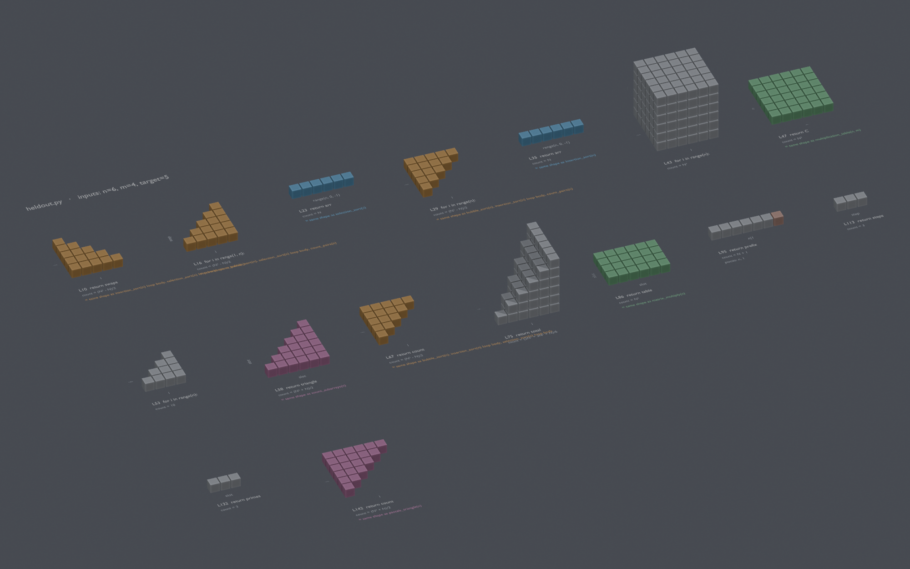

# codeviz: geometry that grows out of code structure

codeviz turns Python code into geometry using a handful of composition rules, then finds which pieces of code share the same structure. It never looks at names: a function called `square_area` that actually draws a triangle is drawn as a triangle.



[中文说明](README.zh.md)

## Principle: rules only, no concepts

`analyzer.py` contains only 8 composition rules (listed at the top of the file). The words "square", "triangle", and "circle" never appear in it.

| Rule | Meaning |
|---|---|
| R1 | A non-negative whole quantity is a length |
| R2 | Multiplying spans a new direction |
| R3 | Adding lays lengths end to end |
| R4 | A loop variable is a position along an axis |
| R5 | Accumulating places each contribution at the loop position where it happened |
| R6 | A collection is a grid of slots; each level of nesting adds a direction |
| R7 | Only code that actually runs counts (conditions carve the shape) |
| R8 | A call sits one level below its caller; successive calls are laid end to end (as in R3) |

**Similarity is never decided by names:**
- **Same shape:** set every input to N and compare the cell sets for several values of N, allowing rotation and reflection.
- **Same law:** the cell count grows by the same polynomial in N (only degree 2 and higher, since linear coincidences are too common).
- **Not polynomial:** if every step multiplies the count by a steady ratio (variation under 3%), the ratio is reported.
- **Logarithmic:** if doubling N always adds a fixed amount, it is reported as c·log₂N. This check runs only for functions that have no law yet, at large N, and a candidate is dropped as soon as doubling N more than doubles the count.
- Only entry functions (those not called by another function) are analyzed on their own; helper functions appear inside their callers' call structure.

## What it finds

### Examples in demo.py

| Code | Shape that appears | Relation found automatically |
|---|---|---|
| `x * x` | square | same shape as `[[0]*n for _ in range(n)]` |
| `a * b * c` | box | |
| `for i: for j in range(i): count += 1` | staircase (triangle) | same shape as `total += i`; same law as `n*(n-1)//2` (Gauss's sum) |
| double loop with `if (x-r)**2+(y-r)**2 <= r*r` | disk | count is not polynomial |
| three loops with `j < i, k < j` | tetrahedron | (N³ − 3N² + 2N)/6 |
| `(x+1)*(x+1)` | square, automatically split into x·x, 1·x, and 1·1 | a geometric proof of x² + 2x + 1 |

### Blind test (heldout.py)

`heldout.py` was written in textbook style by **a separate AI agent that never saw analyzer.py**. It contains 12 classic algorithms. Relations the system found on its own:

- Bubble sort, insertion sort, selection sort, and counting pairs i<j: **one staircase shape**, all with count (N²−N)/2 on the test inputs.
- Pascal's triangle ≅ counting subarrays: a staircase including its diagonal, count (N²+N)/2.
- Naive matrix multiplication: the result is an N² plane, but the work is an **N³ cube**.
- Sum of squares: a square pyramid, count (2N³+3N²+N)/6.
- Binary search and the prime sieve: correctly identified as **not polynomial**.

Bugs this test exposed and that are now fixed: subscript assignment (`arr[j] = ...`, swaps) was not executed; `append` was not supported; `if` conditions did not count as accesses.

### Recursion blind test (heldout_recursion.py)

Also written by an agent that never saw the code: 8 classic recursive algorithms.

- Factorial: a straight line (one self-call).
- Fibonacci: an asymmetric structure; the return value grows by a ratio of **≈ 1.618**, so the system computed the golden ratio by itself.
- Tower of Hanoi: perfectly symmetric halves, growth ratio ≈ 2.
- Merge sort: a halving structure, with the `merge` calls shown inside it in another color.
- Quicksort: lopsided, because this test data always makes the pivot the smallest element. The shape depends on the real data.
- Subset generation: a self-similar (fractal) shape.

Bugs this test exposed and that are now fixed: slices like `arr[:mid]` were not supported; chained assignment `i = j = 0` only assigned the first name; helper functions were analyzed on their own and produced meaningless results.

## Running it

**Live mode (recommended):** double-click `run_live.bat`, or run in a terminal:
```
run_live.bat demo.py
```
`run_live.bat` assumes Blender 5.1 is installed at `C:\Program Files\Blender Foundation\Blender 5.1\`. Edit the `BLENDER` line if yours is elsewhere.

Once Blender opens:
- Edit the code and save; the scene rebuilds automatically.
- **Click any structure and press N:** the CodeViz panel in the Item tab shows its source (with the matching line highlighted), its growth law, the pieces it splits into, and its same-shape and same-law relations.
- **Focus** zooms to that structure, **Show all** returns to the full view, and **Open in editor** jumps to the line in VS Code.
- The bottom of the panel lists every structure; click a name to jump to it.

Structures that are too large are scaled down automatically and labeled with the scale (for example, 1:3.9).

**Render a single image:**
```
"C:\Program Files\Blender Foundation\Blender 5.1\blender.exe" -b --python blender_live.py -- demo.py --render shot.png
```
**See the analysis in a terminal, without Blender:**
```
python analyzer.py demo.py
```
**Test the GUI unattended:** set the environment variable `CODEVIZ_SELFTEST=out.png` (optionally `CODEVIZ_FOCUS=2` to focus the third structure). Blender focuses, takes a screenshot, and exits.

A comment like `#viz n=5` only changes the display size; it does not affect same-shape or same-law decisions.

## Naming and explaining with Claude (explain.py)

**Order matters:** the geometry is built by the rules first, and Claude only sees a shape after it exists. Claude cannot change any cell, law, or relation; it can only name and explain them. If a name in the code does not match the geometry (for example, a function called `square_area` that actually draws a triangle), Claude flags it, shown as `(!)`.

Setup (once):
```
pip install -r requirements.txt
```
and set the environment variable `ANTHROPIC_API_KEY` (or run `ant auth login`).

Usage:
- **In Blender:** click **Ask Claude to explain** in the sidebar. It runs in the background so Blender doesn't freeze; when it finishes, purple "Claude:" names and explanations appear in the panel and as 3D labels.
- **In a terminal:** `python explain.py demo.py`. Add `--dry-run` to print the request without calling the API, or `--lang en` for English explanations (the default is Chinese).

Results are cached in `demo.py.explain.json`. Unchanged code is never sent again, so it isn't charged again; when the code changes, the panel says the explanation is out of date.

## Tests

```
python -m unittest test_analyzer test_explain -v
```
- **Rules:** each rule on its own produces the right cell coordinates.
- **Similarity:** same shape and same law are recognized, different structures are not merged, and mirror images count as the same shape.
- **NamesDoNotMatter:** functions deliberately named `square_area` and variables named `circle` must give exactly the same results as honest names.
- **Robustness:** syntax errors, infinite loops, unsupported syntax, and runtime errors must not crash the program.
- **Mutation, HeldOut, Recursion:** the blind-test results above stay correct.
- `test_explain.py` uses a fake client: no network access and no cost.

## Known limitations

- Only a subset of Python: arithmetic, for/while/if, list comprehensions, `sum`, and function inlining.
- Unsupported operations (`-`, `/`, `%`) keep only their numeric value and are drawn as a single length bar.
- Structures with more than 3 dimensions fold the extra dimensions into height.
- Growth laws are found by exact interpolation over small sizes (N = 2 to 7), so only polynomials up to degree 4 are detected.
